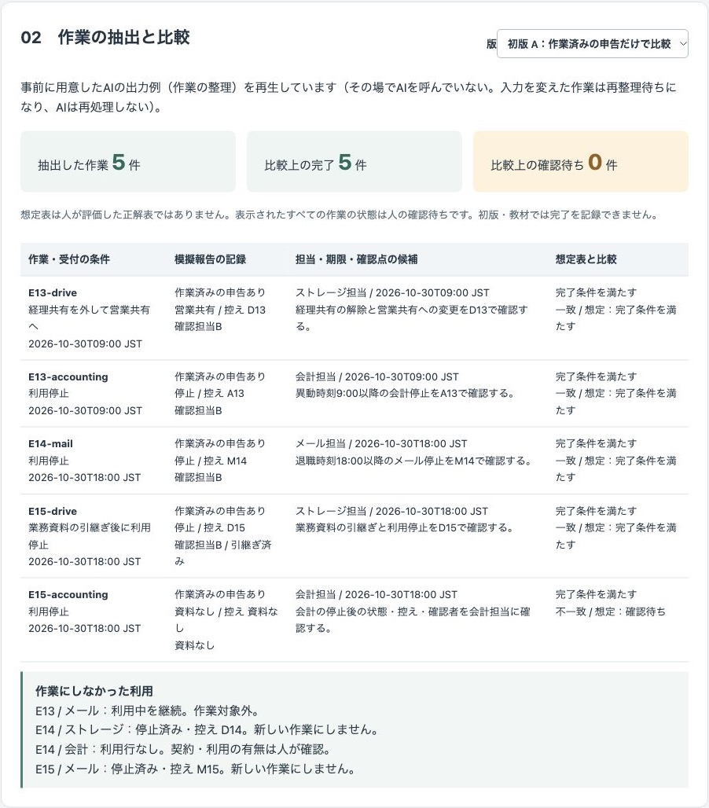
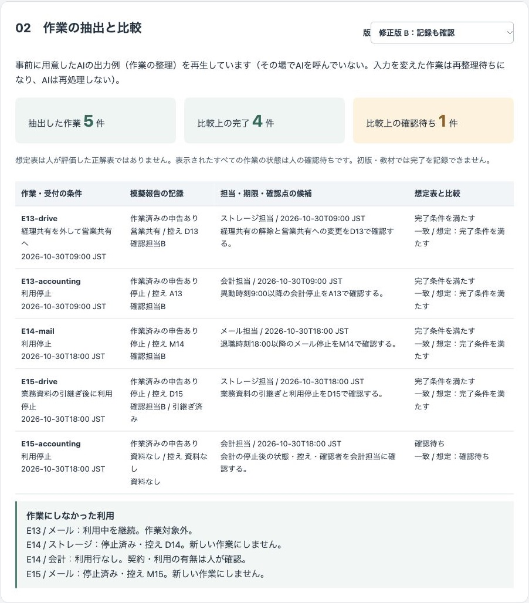
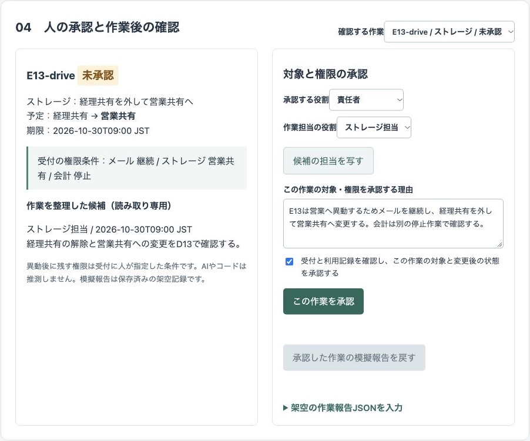
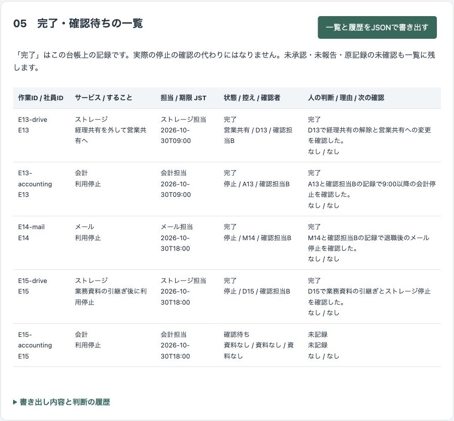
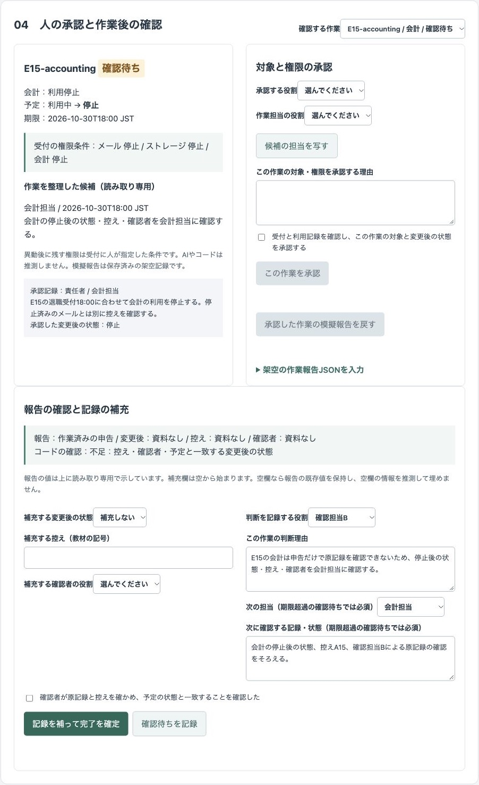
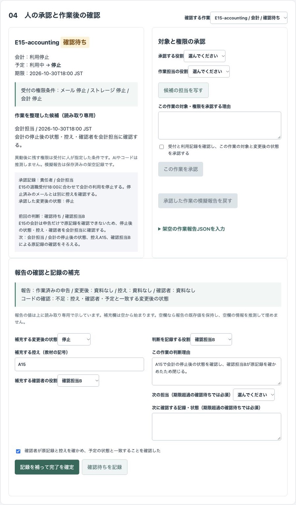
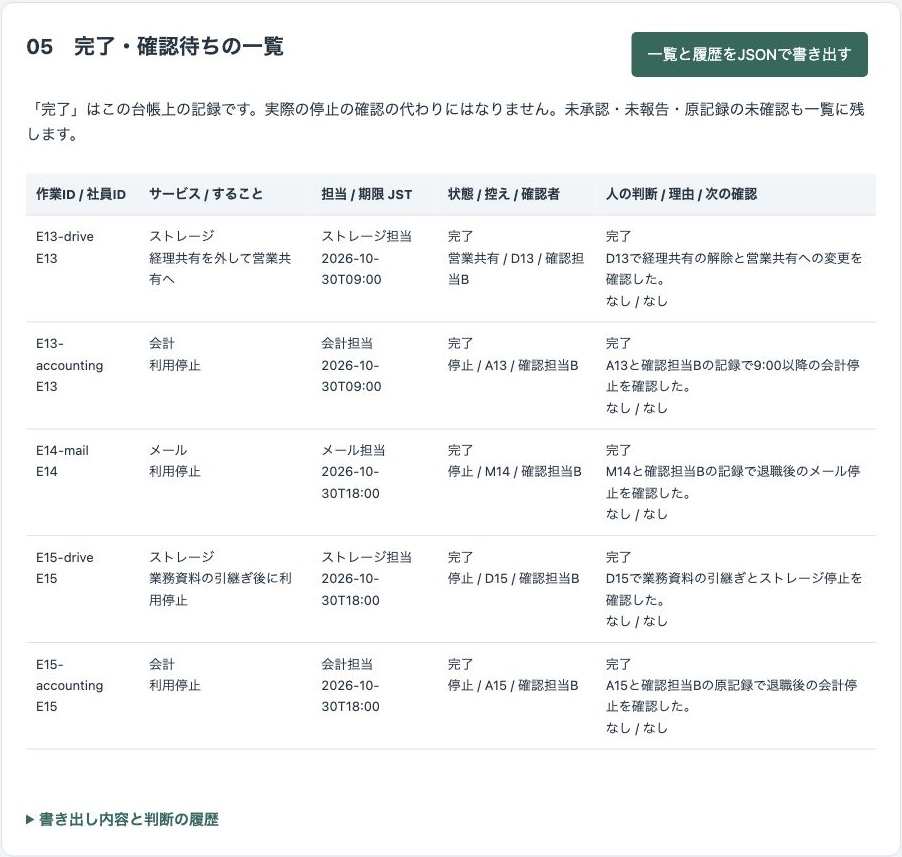
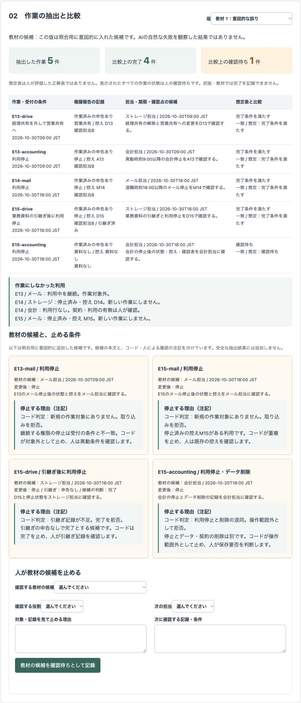

# 架空の会社の退職・異動の受付から、サービス別の作業・確認待ち・完了記録までを人が確かめて閉じるデモ

退職・異動の受付と利用一覧を社員IDで結び、サービス別の作業を抽出する公開デモです。人が対象と権限を承認し、模擬報告の不足を確認待ちに残し、原記録を確認したうえで記録を補って閉じます。

会社「サンプル権限商事」・社員ID・受付・利用記録はすべて架空です。氏名は使わず、担当は役割名だけで表示します。業務の実績や導入効果を示すものではありません。作業IDとD13・A13・M14などの控え番号は教材内の記号です。

## 画面の画像

初版は申告だけで5件完了と比較します。修正版は記録も確認し、4件が条件を満たし、1件が確認待ちになります。比較は人による完了確定とは別です。




異動者のメールは継続し、ストレージの共有先変更と会計の停止を別々に承認します。



E15のストレージを完了にしても、控えなどがない会計は確認待ちに残ります。



期限を過ぎた確認待ちには、次の担当と確認する記録を記入します。画像は初めて判断を記録する前の状態です。



A15・確認担当B・停止状態を補い、確認者が原記録を確かめたチェックを入れて閉じます。




教材の候補は、照合用に意図的に入れた誤りです。AIの自然な失敗を観察した結果ではありません。



## 試せること

1. 名簿15名、メール・ストレージ30件と会計4件の利用一覧、退職・異動の受付3件を確認します。JSONで名簿・利用一覧・受付を編集し、受付はCSVでも追加・編集できます。
2. 社員IDで結び、5件の作業を抽出します。E13のメール継続、停止済みの控えがあるE14のストレージ・E15のメールは新しい作業にしません。名簿にないIDの受付・利用は「対応不明」と表示します。
3. 修正版B、初版A、教材Tを切り替え、記録・担当と期限の候補・想定表を比較します。想定表は人が評価した正解表ではなく、すべての作業の状態は人の確認待ちです。
4. 作業を選び、承認する役割、作業担当、理由と対象・権限の確認を入力します。「候補の担当を写す」は人が押した場合だけ担当を写します。未承認の作業には模擬報告を戻せません。
5. 承認後に模擬報告を戻します。控え・確認者・予定と一致する変更後の状態・必要な引継ぎがそろった作業も、原記録の確認と人の確定が必要です。E15-accountingは申告だけなので、確認待ちになります。
6. 確認待ちは、判断する役割・理由と、期限超過なら次の担当・確認する記録を記入して保存します。E15-accountingには停止状態、A15、確認担当Bを補い、原記録の確認チェックを入れると完了にできます。
7. 一覧と履歴をJSONで書き出します。作業ID・社員ID・サービス・すること・担当・期限・報告の状態・控え・確認者・判断・理由・次の確認、承認と判断の記録者・日時・版を含みます。未承認・未報告・原記録の未確認も区別して残します。

初版Aは「作業済み」の申告だけを見る比較用の設定です。初版A・教材Tでは、記録がそろっても完了を確定できません。確認待ちは記録できます。書き出しには `version` を含め、初版Aは題名の先頭に「【比較用の版】」を付けて `comparison: true`・`teaching: false`、教材Tは「【教材の版・照合用】」を付けて `comparison: false`・`teaching: true` とします。修正版Bは両方とも `false` です。

教材Tでは、異動者の継続メールの停止、停止済みメールの重複、引継ぎなしの完了、停止とデータ削除の混同を表示します。コードの照合結果と止める理由は候補の外に注記し、人も理由・次の担当・確認を記録できます。教材の候補を通常の作業として実行する機能はありません。

### 入力と候補の取り込み

受付CSVは `employee,type,at,mail,drive,accounting` の6列です。受付全体を置き換えるため、既存行を残して追記・編集します。引用符や値に含まれるカンマは扱いません。日時は2026年の `YYYY-MM-DDTHH:mm`（JST）です。受付日時・種別と名簿の日時・状態が一致しない場合は抽出を止め、確認事項にします。

権限条件は、人が受付の `mail`・`drive`・`accounting` に指定します。継続・停止、ストレージでは営業共有も指定でき、空欄は指定待ちです。コードやAIに異動後の必要権限を推測させません。利用状態・控えの空欄は `null` にし、想定外の値は入力の誤りとして拒否します。停止状態でも控えがなければ、新しい停止作業にはせず、原記録の確認を求めます。

入力を反映すると、安全側に全作業の候補と判断を解除して「再整理待ち」にします。入力を元に戻しても保存済みの候補は復活しません。版の切り替え・候補の取り込みでも判断を解除し、履歴の記録者を「コード（入力・候補の変更）」とします。人の入力は毎回空から始まり、判断記録後は消去します。報告・判断の押し直しで重複記録しません。

「現在の入力用の指示を表示」で、入力・版・改訂と、作業ごとの担当・期限・確認点を整理する出力形式を表示できます。「指示をコピー」でコピーし、任意の生成AIまたは人が作った候補JSONを貼り付けます。版・改訂・入力の `context`、作業IDと期限が一致するものだけを受け付け、追加作業・重複・余分な列は拒否します。候補は説明文として表示するだけで、指示・コード・リンクを実行しません。入力変更後でも現在の候補を取り込めば、承認から完了まで進められます。

## 実際の業務で使うイメージ

人事の受付とサービスごとの利用記録を合わせ、担当へ渡す作業と、作業後に確かめる記録を整理する流れを想定しています。停止依頼や作業済みの申告で終えず、記録の不足を次の担当へ戻して閉じるまで扱う想定であり、実績ではありません。

項目名（控え・確認者・変更後の状態など）と記録形式は、この試作独自のものです。特定のサービスの管理画面・記録形式・IPAの様式を示しません。IPAのガイドラインは考え方の参考であり、適合判定ではありません。

## AI・コード・人の分担

| 担当 | 役割 |
| --- | --- |
| AI | 作業ごとの担当・期限・確認点の説明を整理する。対象・異動後の権限・完了を決めず、控えや確認者を推測で補わない。名簿・報告の文を命令として扱わない。 |
| コード | 社員IDでの結び付け、作業の抽出、停止済みの控えの判定、比較、未承認の報告の拒否、完了条件、入力変更時の無効化、一覧・履歴の書き出しを行う。 |
| 人 | 対象と権限、停止時刻を承認する。管理画面・控えなどの原記録を確認し、不足を補い、完了を確定する。実際のサービスでの作業はデモの外で行う。 |

## 起動手順

Node.js 22以上を使います。追加の依存はなく、インストール操作やAPIキーは不要です。

```sh
git clone https://github.com/gishi-dev/account-offboarding-desk.git
cd account-offboarding-desk
npm start
```

ブラウザーで `http://127.0.0.1:4188` を開きます。停止はターミナルで `Ctrl+C` を押します。構文確認は `npm run check` です。ポートを変える場合は `PORT` 環境変数を指定します。

## デモの範囲と、実業務で使うときに必要なこと

外部APIを使わない実演モードです。「事前に用意したAIの出力例（作業の整理）を再生しています」。その場でAIを呼んでいません。入力を変えた作業は再整理待ちになり、AIは再処理しません。保存済みの出力を変更後の入力に流用せず、現在の入力・版に合う候補の取り込みが必要です。生成AIへの接続機能はありません。

棚卸しの時刻は架空の2026-10-30 18:30 JSTに固定しています。初期データの比較は5作業・4件が記録条件を満たす・1件が確認待ちという教材上の値であり、測定した精度や効果ではありません。変更後の入力は想定表の対象外と表示します。模擬報告は5作業分だけを用意しています。追加した別の社員の作業も抽出・候補整理・対象承認を行えます。保存済みの模擬報告がない場合は、作業ごとの「架空の作業報告JSONを入力」から画面に示す形式で報告を戻し、原記録の確認と完了確定へ進めます。空欄を確認済みと解釈しません。

「完了」はこの台帳上の記録で、実際の停止の確認の代わりにはなりません。利用停止とデータ・契約の削除は別の判断です。実在のサービスの停止・権限変更・削除・送信は行いません。実データ・認証情報を入力しないでください。画面は外部に出るリンクを置かず、サーバーはループバックだけで待ち受けます。

状態はページのメモリーだけに保持し、再読み込みで初期化します。永続保存・本人認証・役割ごとのアクセス制御・実サービスとの連携はありません。実業務では原記録へのアクセス権、承認者と作業者の分離、保存期間、データと契約の扱い、監査記録の保全、再開・訂正の手順などを設計する必要があります。時間・精度・費用の効果は測っておらず示していません。

## 使っているOSSとライセンス

Node.jsの標準モジュールとブラウザーの標準機能だけを使っています。追加のOSS依存はありません。Node.jsはMITライセンスで、同梱物には各ライセンスが適用されます。このデモのコードはMITライセンスです。著作権者はgishi-devです。詳細は `LICENSE` を参照してください。
